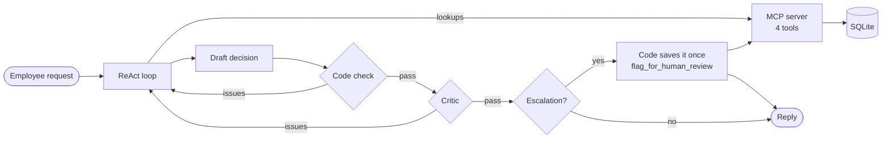

# IT Equipment Request Handler

An MCP server and a ReAct agent that handle internal IT equipment requests. An employee asks in
plain words ("Can I get a second monitor?"); the agent looks up their role, equipment and policy
through four MCP tools, then **approves**, **denies**, or **escalates** the request to a human with
a reason code. Every draft decision is reviewed before it becomes final.

```
Request: E003: One of my monitors died, can I get a replacement?

Step 1  Thought:     I need the employee's records and the eligibility check for a monitor.
        Action:      get_employee_info({"employee_id": "E003"})
Step 2  Action:      check_request_eligibility({"employee_id": "E003", "item": "monitor"})
        Observation: {"status": "not_eligible", "reason_code": "REFRESH_NOT_DUE", ...}
Step 3  Action:      submit_decision({"decision": "escalate", "reason_code": "EXCEPTION_REQUEST", ...})
Reflection: draft 1   Code check: pass   Critic: pass
Step 4  Actor:       code
        Action:      flag_for_human_review(...)  ->  {"escalation_id": "ESC-90357dad", "status": "open"}

Decision:    ESCALATE (EXCEPTION_REQUEST)
Message:     ... a person needs to decide on it. Sent for human review. Reference: ESC-90357dad.
```

## How it works



- **Rules live in code, language lives in the model.** Eligibility is decided by plain, tested
  Python behind the MCP tools; the model reads the request, spots claims and contradictions, and
  writes the reply.
- **Reflection before anything is final.** A code check compares the draft with the tool results
  in rule order; a separate critic checks the decision, the message and the note for the human
  reviewer. A rejected draft goes back to the same loop with the issues (at most 2 revisions).
- **The model never writes.** It is only offered the three lookup tools. Once an escalation passes
  review, code calls `flag_for_human_review` once and adds the reference to the reply; a save that
  is not confirmed is reported, never announced.
- **Safe fallbacks.** A step limit, a refusal, or a draft that never passes review is escalated by
  code with a standard message.

The full rules are in [docs/requirements.md](docs/requirements.md).

## MCP tools

| Tool | Input | Returns | Writes |
|---|---|---|---|
| `get_employee_info` | `employee_id` | role, tenure, equipment on file with ages | no |
| `get_policy_limits` | `role` | max quantity and refresh interval per item | no |
| `check_request_eligibility` | `employee_id`, `item` | `eligible` / `not_eligible` / `needs_review`, reason code, the numbers used | no |
| `flag_for_human_review` | `employee_id`, `request`, `reason`, `reason_code` | escalation ID, status `open` | yes |

Errors are returned as data (`{"error": "EMPLOYEE_NOT_FOUND", ...}`) so the agent can reason
about them.

## Quick start

Requirements: Python 3.12, [uv](https://docs.astral.sh/uv/), and an LLM deployment on Azure AI
Foundry (Anthropic API). Docker is optional.

```sh
uv sync                     # install
cp .env.example .env        # then fill in the Foundry key, endpoint and deployment name
uv run seed                 # create data/equipment.db with the demo employees and policies
```

Run the server in one terminal and the agent in another:

```sh
uv run --env-file .env server                     # MCP server on http://127.0.0.1:8000/mcp
uv run --env-file .env agent --scenario 3         # one of the 4 demo requests (1-4)
uv run --env-file .env agent --employee E001 --text "Can I get a headset?"
```

With `MCP_TRANSPORT=stdio`, the agent starts the server itself and no second terminal is needed.
To check the MCP connection on its own, without the model:

```sh
uv run python -m equipment.agent.mcp_client                                              # list tools
uv run python -m equipment.agent.mcp_client get_employee_info '{"employee_id": "E001"}'  # call one
```

### Demo requests

| # | Employee | Request | Outcome |
|---|---|---|---|
| 1 | E001 | Can I get a second monitor? And can I have it by Friday? | approve, `WITHIN_LIMIT` (no date promised) |
| 2 | E002 | I need a company laptop for my project. | deny, `ROLE_NOT_ELIGIBLE` |
| 3 | E003 | One of my monitors died, can I get a replacement? | escalate, `EXCEPTION_REQUEST` |
| 4 | E004 | My laptop is 4 years old and really slow, I need a new one. | escalate, `CLAIM_CONTRADICTS_RECORDS` |

### Docker

```sh
docker compose up -d --build mcp-server            # server container on http://127.0.0.1:8000/mcp
docker compose run --rm agent --scenario 3         # agent container, reads .env
```

The database lives in the `equipment-data` volume and is seeded on first start.

## Configuration

Set in `.env` (see [.env.example](.env.example)). Only the first three are required.

| Variable | Purpose | Default |
|---|---|---|
| `ANTHROPIC_FOUNDRY_API_KEY` | Foundry API key | — |
| `ANTHROPIC_FOUNDRY_BASE_URL` | Foundry endpoint URL (or `ANTHROPIC_FOUNDRY_RESOURCE`, not both) | — |
| `AGENT_MODEL` | Foundry deployment name | — |
| `MCP_TRANSPORT` | `streamable-http` or `stdio` | `streamable-http` |
| `MCP_HOST` / `MCP_PORT` | Where the server listens | `127.0.0.1` / `8000` |
| `MCP_ALLOWED_HOSTS` | Required when the server listens on a non-local address | — |
| `EQUIP_DB_PATH` | SQLite database file | `./data/equipment.db` |
| `AS_OF_DATE` | Fixed "today" for policy dates, so results are reproducible | today |

## Tests

```sh
uv run pytest                                   # 372 unit, MCP and loop tests; no model calls
uv run ruff check . && uv run ruff format --check .
uvx pyright --pythonpath .venv/bin/python src/equipment
```

The agent and reflection tests use a scripted model against the real MCP server, so they are fast
and free. Live tests call the real model and are opt-in:

```sh
uv run --env-file .env pytest -m eval -s tests/evals/test_reflection_live.py     # critic and fault injection
uv run --env-file .env pytest -m eval -s tests/evals/test_comparison_live.py     # before/after reflection
```

The comparison and how to read it are described in [docs/evaluation.md](docs/evaluation.md).

## CI

[GitHub Actions](.github/workflows/ci.yml) runs two jobs:

- **test**, on every push and pull request: lint, unit and smoke tests, the Docker image, and a
  Compose check with the server and agent in separate containers over HTTP.
- **agent-eval**, after a merge into `main` (or on demand): five live tests, the four demo requests
  and a fault-injection reflection test. Live tests never run on pull requests.

## Project layout

```
src/equipment/
  server.py            MCP server: the four tools, transport and host checks
  tools.py             the plain functions behind each tool
  domain/policy.py     eligibility rules and date arithmetic
  data/                schema, seed data and the SQLite repository
  agent/
    react.py           the ReAct loop, review and the single save
    mcp_client.py      MCP client over Streamable HTTP or stdio
    checks.py          reflection, part 1: the code check
    reflection.py      reflection, part 2: the critic
    prompts.py         drafter and critic instructions
    llm.py             the Foundry client
    types.py           validated models for drafts, results and decisions
    trace.py           the Thought / Action / Observation printer
    cli.py             `uv run agent`
scenarios/             demo and evaluation requests
tests/                 unit tests; tests/evals/ holds the live tests
docs/                  requirements and evaluation notes
```

## Known limitation

Within one run an escalation is saved at most once. If a save cannot be confirmed (for example a
timeout after the database wrote it), the employee is asked to submit again, which can create a
second ticket. A stable request ID reused on retry would prevent this.
